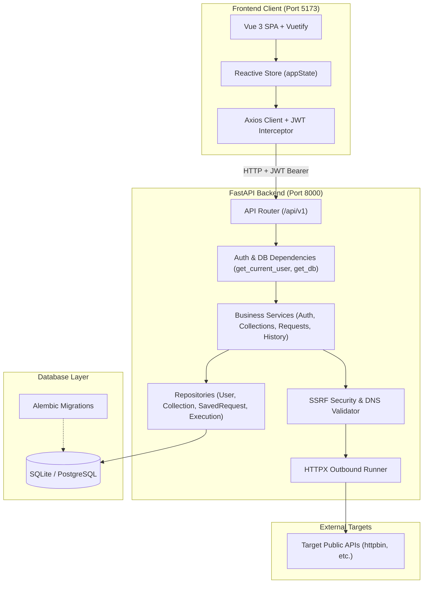
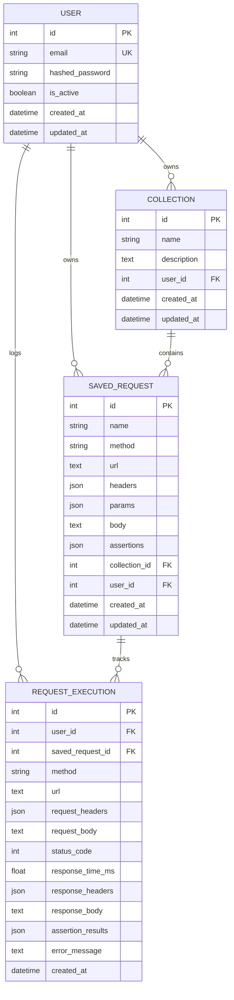

# API Sentinel — Architecture Documentation

API Sentinel is a simplified, portfolio-grade API testing platform designed with clean separation of concerns, defensive security protections, and complete multi-tenant user isolation.

---

## 1. System Architecture Overview

The application follows a modern decoupled architecture:
* **Frontend:** Single-Page Application (SPA) built with Vue 3, Vite, and Vuetify (Material Design 3).
* **Backend:** Asynchronous REST API built with FastAPI and Pydantic v2.
* **Database & ORM:** SQLite for zero-configuration local development, managed via SQLAlchemy 2.x and Alembic schema migrations.
* **Outbound Execution Engine:** High-performance async HTTP client (HTTPX) fortified with custom SSRF (Server-Side Request Forgery) validators.



---

## 2. Layered Architecture & Separation of Concerns

```
api/v1/endpoints/  -->  HTTP Routing, Request Validation, Dependency Injection
services/          -->  Business Logic, Outbound HTTP Execution, Assertion Evaluation
repositories/      -->  Direct Database Operations (Strict User Ownership Scoping)
models/            -->  SQLAlchemy 2.0 Declarative ORM Models
schemas/           -->  Pydantic v2 Serialization & Input Validation
core/              -->  Security (Bcrypt, JWT), Settings (Pydantic BaseSettings), SSRF Validator
```

### Why this structure?
1. **API Endpoints (`app/api/`)** do not contain database queries or HTTP client logic. They only coordinate between HTTP requests, services, and Pydantic response models.
2. **Services (`app/services/`)** enforce business constraints. For example, `saved_request_service` checks whether a user owns the target collection before allowing a request to be added.
3. **Repositories (`app/repositories/`)** enforce data-access security. Every query filters by `user_id`, preventing horizontal privilege escalation.
4. **Schemas (`app/schemas/`)** prevent secret leakage. Database models hold fields like `hashed_password`, but public Pydantic schemas filter out sensitive attributes before JSON serialization.

---

## 3. Database Schema & Entity Relationships



* **Cascading Deletes:** Deleting a `Collection` automatically deletes all its associated `SavedRequest` records (`cascade="all, delete-orphan"`), preventing orphan records.
* **Soft Foreign Key on Executions:** If a `SavedRequest` is deleted, its past historical logs in `request_executions` remain preserved for audit purposes with `saved_request_id = NULL` (`ondelete="SET NULL"`).

---

## 4. Security Threat Modeling & Defenses

### A. Server-Side Request Forgery (SSRF) Protection
Allowing arbitrary outbound HTTP requests is the primary attack vector for API testing platforms. API Sentinel defends against SSRF through multi-stage validation:

| Threat | Attack Scenario | Defense Implemented in `app/core/ssrf.py` |
| :--- | :--- | :--- |
| **Cloud Metadata Theft** | Requesting `http://169.254.169.254/latest/meta-data/` | Explicitly blacklists known cloud metadata IPs (`169.254.169.254`, `100.100.100.200`, `fd00:ec2::254`). |
| **Internal Port Scanning** | Scanning `http://127.0.0.1:22` or `http://localhost:8000` | Rejects loopback addresses (`127.0.0.0/8`, `::1`) and hostnames (`localhost`, `metadata.google.internal`). |
| **Private Subnet Access** | Requesting internal company services (`http://192.168.1.1` or `http://10.0.0.1`) | Resolves domain names to IP addresses via `socket.getaddrinfo` and checks against `ipaddress.is_private`. |
| **Protocol Abuse** | `file:///etc/passwd`, `gopher://`, `ssh://` | Restricts allowed URL schemes strictly to `http` and `https`. |
| **Open Redirect SSRF Bypass** | Initial public URL returns HTTP 302 redirecting to `http://127.0.0.1` | Redirects are **disabled by default**. If enabled, every redirect hop re-validates the new destination URL through the full SSRF validator. |
| **Credential Theft via Redirect** | User includes `Authorization: Bearer <token>`, target redirects to evil.com | The runner detects when redirect crosses to a different hostname and automatically strips `Authorization` headers. |

### B. Denial of Service (DoS) Protections
* **Connection & Read Timeouts:** Outbound requests timeout after 10 seconds (`OUTBOUND_REQUEST_TIMEOUT_SECONDS`).
* **Streaming Response Size Limit:** Instead of buffering full responses in memory, the engine streams incoming bytes (`aiter_bytes`). If a response exceeds 5 MB (`OUTBOUND_MAX_RESPONSE_BYTES`), execution is aborted immediately.
* **Database Truncation:** Stored response bodies in SQLite are capped at 250 KB to avoid memory bloat.

### C. Authentication & Authorization
* **Password Hashing:** Passwords are never stored in plaintext. They are salted and hashed using `bcrypt` (12 rounds).
* **JWT Expiration:** Tokens are cryptographically signed using HMAC-SHA256 (`HS256`) and expire automatically after 60 minutes.
* **ID Guessing Defense:** Attempting to read, update, or delete another user's collection or request returns `404 Not Found` rather than `403 Forbidden`, preventing attackers from confirming that a resource ID exists.
* **Sensitive Data Redaction:** Execution logs automatically redact `Authorization`, `Cookie`, `X-Api-Key`, and `Proxy-Authorization` header values before saving to the database.

